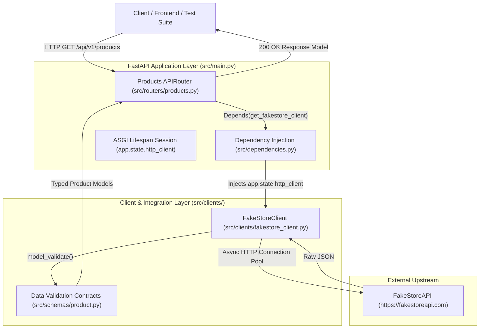
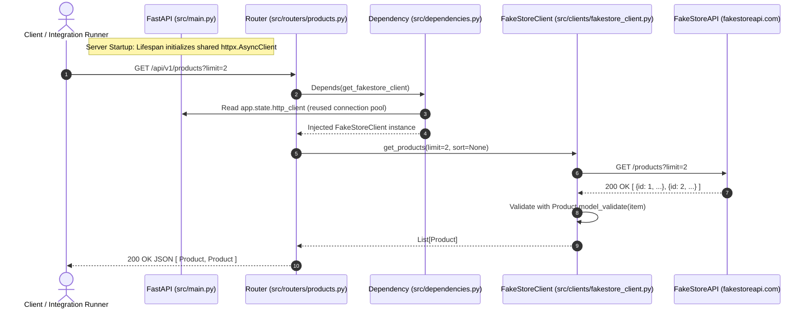

# Milestone 1: Backend Integration & E-Commerce Service Foundation

This documentation provides an architectural overview and technical implementation guide for **Milestone 1** of the Multi-Agent Business Orchestration Platform. 

It details the implementation of the external e-commerce service integration connecting FastAPI to the external **FakeStoreAPI**, including data validation schemas, resilient asynchronous HTTP clients, dependency-injected connection pools, RESTful endpoints, and automated verification suites.

---

## 1. System Architecture & Component Interaction

The platform follows a layered, decoupled service architecture adhering to the 12-factor application methodology:



### Request-Response Execution Flow



---

## 2. Project Directory Structure

Following enterprise conventions, routing, schemas, dependencies, and external clients are structured cleanly in their own dedicated modules:

```
Business_ops_GoogleADK/
├── .env.dev                        # Local development environment configuration
├── .env.example                    # Template environment variables
├── .env.prod                       # Production environment configuration
├── .gitignore                      # Git exclusion rules (venv, secrets, pycache)
├── pytest.ini                      # Pytest runner configuration (asyncio mode, pythonpath)
├── requirements.txt                # Project dependencies (FastAPI, HTTPX, Pydantic, etc.)
├── run.py                          # Local development runner with argparse & uvicorn
├── adk_ops_docs/                   # Architecture & operations documentation
│   ├── Enterprise Configuration and Architecture Guide.md
│   ├── git_ssh_authentication_guide.md
│   ├── python backend my notes.md
│   └── v1_backend_integration.md   # [This Document]
├── src/
│   ├── __init__.py
│   ├── config.py                   # Pydantic BaseSettings singleton & env resolver
│   ├── dependencies.py             # FastAPI dependency providers for HTTP & service clients
│   ├── main.py                     # FastAPI app, lifespan connection manager & route mounting
│   ├── clients/                    # External API integration clients
│   │   ├── __init__.py
│   │   └── fakestore_client.py     # Asynchronous client for FakeStoreAPI
│   ├── routers/                    # REST API route controllers
│   │   ├── __init__.py
│   │   └── products.py             # Product catalog & category endpoints
│   └── schemas/                    # Pydantic v2 data models & validation schemas
│       ├── __init__.py
│       └── product.py              # Product and Rating domain schemas
└── tests/                          # Automated testing & verification suites
    ├── __init__.py
    ├── test_health.py              # Health check & liveness tests
    ├── test_products.py            # Unit tests with client mocking & error handling
    └── verify_live_fakestore.py    # Live integration test against real FakeStoreAPI
```

---

## 3. Environment & Virtual Environment Setup

### 3.1. Virtual Environment Creation
The project is decoupled from global system packages using a dedicated Python 3.12 virtual environment:
```powershell
python -m venv .venv
.\.venv\Scripts\Activate.ps1
```

### 3.2. Dependencies (`requirements.txt`)
All dependencies are locked with version constraints:
```text
fastapi>=0.115.0
httpx>=0.27.0
pydantic>=2.8.0
pydantic-settings>=2.4.0
python-dotenv>=1.0.1
rich>=13.7.1
uvicorn[standard]>=0.30.0
pytest>=8.0.0
pytest-asyncio>=0.23.0
```

### 3.3. Hardened `.gitignore`
To prevent leaking credentials or committing temporary build artifacts, `.gitignore` explicitly filters:
- Virtual environments (`.venv/`, `venv/`)
- Compiled Python byte code (`__pycache__/`, `*.pyc`)
- Secrets and dot-env files (`.env`, `.env.*`, while whitelisting `!.env.example`)
- Pytest caches (`.pytest_cache/`)
- Local IDE/Obsidian workspace metadata (`.obsidian/`, `.vscode/`)

---

## 4. Data Contracts & Domain Schemas (`src/schemas/product.py`)

Using **Pydantic v2**, schemas enforce strict type validation, field ranges, and documentation examples for all data entering and leaving the system.

```python
from typing import Optional
from pydantic import BaseModel, ConfigDict, Field


class Rating(BaseModel):
    """Product review and rating metrics."""
    rate: float = Field(
        ...,
        ge=0.0,
        le=5.0,
        description="Average customer rating score (0.0 to 5.0)",
        examples=[3.9],
    )
    count: int = Field(
        ...,
        ge=0,
        description="Total count of customer ratings submitted",
        examples=[120],
    )

    model_config = ConfigDict(from_attributes=True)


class Product(BaseModel):
    """E-commerce product entity representation from FakeStoreAPI."""
    id: int = Field(
        ...,
        ge=1,
        description="Unique product identifier",
        examples=[1],
    )
    title: str = Field(
        ...,
        min_length=1,
        description="Title or display name of the product",
        examples=["Fjallraven - Foldsack No. 1 Backpack, Fits 15 Laptops"],
    )
    price: float = Field(
        ...,
        ge=0.0,
        description="Unit price in USD",
        examples=[109.95],
    )
    description: str = Field(
        ...,
        description="Detailed product description",
        examples=["Your perfect pack for everyday use and walks in the forest."],
    )
    category: str = Field(
        ...,
        min_length=1,
        description="Product categorization classification",
        examples=["men's clothing"],
    )
    image: str = Field(
        ...,
        description="HTTP URL pointing to the product imagery asset",
        examples=["https://fakestoreapi.com/img/81fPKd-2AYL._AC_SL1500_.jpg"],
    )
    rating: Optional[Rating] = Field(
        default=None,
        description="Aggregate rating score and review count",
    )

    model_config = ConfigDict(from_attributes=True)
```

### Architectural Key Points
1. **Validation Boundaries**: Numeric fields enforce boundaries (`ge=0.0`, `le=5.0`). If the upstream API returns negative prices or invalid ratings, Pydantic catches it immediately before corrupted data propagates to consumers.
2. **`ConfigDict(from_attributes=True)`**: Enables compatibility with ORMs or raw object attributes.
3. **Optional Sub-models**: `rating` is defined as `Optional[Rating] = None` to gracefully handle products that do not have customer reviews yet.

---

## 5. Resilient External Client (`src/clients/fakestore_client.py`)

The `FakeStoreClient` encapsulates all network interactions with the external FakeStoreAPI.

### Custom Exception Hierarchy
```python
class FakeStoreError(Exception):
    """Base exception for FakeStoreAPI operations."""
    pass

class FakeStoreItemNotFoundError(FakeStoreError):
    """Raised when a requested product or entity is not found upstream."""
    pass

class FakeStoreUpstreamError(FakeStoreError):
    """Raised when upstream service returns an unrecoverable HTTP error or network failure."""
    def __init__(self, message: str, status_code: Optional[int] = None):
        super().__init__(message)
        self.status_code = status_code
```

### Why Custom Exceptions?
By abstracting network and protocol errors into domain-specific exceptions (`FakeStoreItemNotFoundError`, `FakeStoreUpstreamError`), the router code remains completely decoupled from `httpx` implementation details. If the underlying HTTP library changes in the future, the routers do not need to change.

### Upstream Quirks Handling (FakeStoreAPI 404 Behavior)
A critical implementation detail in `get_product()`:
> **FakeStoreAPI Quirk**: When an ID does not exist (e.g. `GET /products/99999`), FakeStoreAPI does not return HTTP 404. Instead, it returns `HTTP 200 OK` with an empty body or JSON `null`.
>
> The client explicitly handles this:
```python
text = response.text.strip()
if not text or text == "null":
    raise FakeStoreItemNotFoundError(f"Product with ID {product_id} not found.")
```

---

## 6. Connection Lifecycle & Lifespan Pooling (`src/main.py`)

In enterprise async applications, creating a new `httpx.AsyncClient` on every request incurs severe performance penalties:
- Every request would force a new TCP 3-way handshake.
- Every request would force a new TLS certificate exchange.
- Socket exhaustion occurs under high concurrency.

### The Solution: Lifespan Connection Pooling
We configure a single shared `httpx.AsyncClient` inside FastAPI's **ASGI lifespan context manager**:

```python
@asynccontextmanager
async def lifespan(app: FastAPI):
    settings = get_settings()
    
    # 1. Initialize shared HTTP client with connection pooling
    app.state.http_client = httpx.AsyncClient(
        base_url=settings.ECOMMERCE_API_BASE_URL,
        timeout=settings.HTTP_TIMEOUT,
    )

    yield

    # 2. Clean shutdown: gracefully close open connection pools and sockets
    if hasattr(app.state, "http_client") and app.state.http_client is not None:
        await app.state.http_client.aclose()
```

### Dependency Provider (`src/dependencies.py`)
FastAPI injects this pooled client cleanly into any route:

```python
def get_http_client(request: Request) -> httpx.AsyncClient:
    """Retrieve shared httpx.AsyncClient from app.state."""
    if hasattr(request.app.state, "http_client") and request.app.state.http_client is not None:
        return request.app.state.http_client
    return httpx.AsyncClient()

def get_fakestore_client(
    client: httpx.AsyncClient = Depends(get_http_client),
) -> FakeStoreClient:
    """Provides initialized FakeStoreClient leveraging shared connection pool."""
    return FakeStoreClient(client=client)
```

---

## 7. Product & Category API Endpoints (`src/routers/products.py`)

All endpoints are mounted under `/api/v1` in `src/main.py`:

| Method | Endpoint | Description | Query / Path Parameters |
| :--- | :--- | :--- | :--- |
| `GET` | `/api/v1/products` | Retrieve catalog of products | `limit: Optional[int]`, `sort: Optional[str]` ("asc", "desc") |
| `GET` | `/api/v1/products/categories` | Retrieve all category names | None |
| `GET` | `/api/v1/products/category/{category_name}` | Retrieve products by category | `category_name: str` (path), `limit`, `sort` |
| `GET` | `/api/v1/products/{product_id}` | Retrieve individual product | `product_id: int` (path) |

### Route Registration Ordering Rule
In FastAPI, routes are evaluated in the order they are defined:
```python
# 1. Category route MUST come before /{product_id}
@router.get("/categories", response_model=List[str])
async def list_categories(...):
    ...

# 2. Dynamic integer path
@router.get("/{product_id}", response_model=Product)
async def get_product(product_id: int = Path(..., ge=1), ...):
    ...
```
If `/{product_id}` were defined first, a request to `/api/v1/products/categories` would attempt to parse `"categories"` as an integer `product_id` and fail with HTTP 422 Unprocessable Entity. Declaring `/categories` first prevents this collision.

---

## 8. Automated Testing & Verification Suite

### 8.1. Pytest Unit & Mock Test Suite (`tests/test_products.py`)
Tests verify endpoint contracts, query parameters, not-found behavior, and upstream errors using mock dependency injection (`app.dependency_overrides`):

```bash
.\.venv\Scripts\pytest -v
```

**Results:**
```text
============================= test session starts =============================
platform win32 -- Python 3.12.10, pytest-9.2.0, pluggy-1.7.0
rootdir: C:\Users\Harsh\HiHarsh\Coding\Python\Business_ops_GoogleADK
configfile: pytest.ini
plugins: anyio-4.16.0, asyncio-1.4.1.post1
collected 9 items

tests/test_health.py::test_health_endpoint PASSED                        [ 11%]
tests/test_health.py::test_root_endpoint PASSED                          [ 22%]
tests/test_products.py::test_get_all_products PASSED                     [ 33%]
tests/test_products.py::test_get_products_with_limit PASSED              [ 44%]
tests/test_products.py::test_get_product_by_id_success PASSED            [ 55%]
tests/test_products.py::test_get_product_by_id_not_found PASSED          [ 66%]
tests/test_products.py::test_get_categories PASSED                       [ 77%]
tests/test_products.py::test_get_products_by_category PASSED             [ 88%]
tests/test_products.py::test_upstream_error_handling PASSED              [100%]

======================== 9 passed in 5.05s =========================
```

---

### 8.2. Live End-to-End Verification (`tests/verify_live_fakestore.py`)
To ensure total real-world compatibility, the live verification suite executes live HTTP requests against the actual `https://fakestoreapi.com` service:

```bash
.\.venv\Scripts\python.exe -m tests.verify_live_fakestore
```

**Live Verification Output Log:**
```text
==================================================
 LIVE FAKESTORE API INTEGRATION VERIFICATION
==================================================
================================================================
  Multi-Agent Business Orchestration Platform Starting
  Environment       : DEV
  Bound Host / Port : 0.0.0.0:8000
  Application URL   : http://localhost:8000
  API Docs (Swagger): http://localhost:8000/docs
  Ecommerce Base URL: https://fakestoreapi.com
  HTTP Timeout      : 15.0s
================================================================

[1] Testing /health ...
Status: 200
Body: {'status': 'healthy'}

[2] Testing GET /api/v1/products?limit=2 ...
Status: 200
Fetched 2 products:
  - ID 1: Fjallraven - Foldsack No. 1 Backpack, Fi... ($109.95) Category: men's clothing
  - ID 2: Mens Casual Premium Slim Fit T-Shirts ... ($22.3) Category: men's clothing

[3] Testing GET /api/v1/products/1 ...
Status: 200
Product: ID=1, Title=Fjallraven - Foldsack No. 1 Backpack, Fits 15 Laptops, Rating={'rate': 3.9, 'count': 120}

[4] Testing GET /api/v1/products/categories ...
Status: 200
Categories: ['electronics', 'jewelery', "men's clothing", "women's clothing"]

[5] Testing GET /api/v1/products/category/jewelery?limit=2 ...
Status: 200
Fetched 2 items in 'jewelery':
  - John Hardy Women's Legends Naga Gold & S... ($695.0)
  - Solid Gold Petite Micropave ... ($168.0)

[6] Testing GET /api/v1/products/99999 (Non-existent ID) ...
Status: 404
Detail: {'detail': 'Product with ID 99999 not found.'}
Shutting down Multi-Agent Business Orchestration Platform cleanly...

==================================================
 ALL LIVE VERIFICATION CHECKS PASSED SUCCESSFULLY!
==================================================
```

---

## 9. Quick Start Guide for Developers

### Starting the Local Development Server
Use the `run.py` launcher script:
```powershell
.\.venv\Scripts\python.exe run.py -e dev
```

### Accessing Interactive API Documentation
Once running, the interactive OpenAPI Swagger documentation is available in your browser at:
- **Swagger UI**: `http://localhost:8000/docs`
- **ReDoc**: `http://localhost:8000/redoc`
- **OpenAPI Schema**: `http://localhost:8000/openapi.json`

### Example cURL Commands
```bash
# Health check
curl http://localhost:8000/health

# List 5 products sorted descending
curl "http://localhost:8000/api/v1/products?limit=5&sort=desc"

# Get categories
curl http://localhost:8000/api/v1/products/categories

# Get products in 'electronics'
curl "http://localhost:8000/api/v1/products/category/electronics"

# Fetch product #1
curl http://localhost:8000/api/v1/products/1
```
